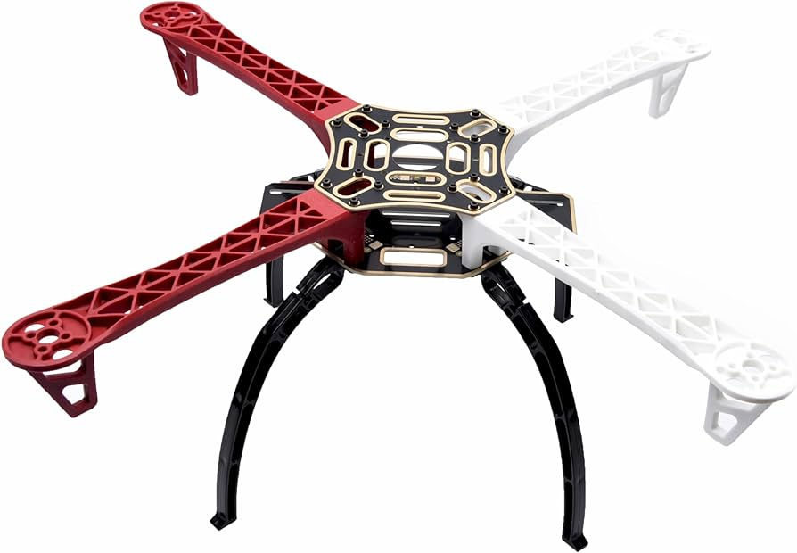
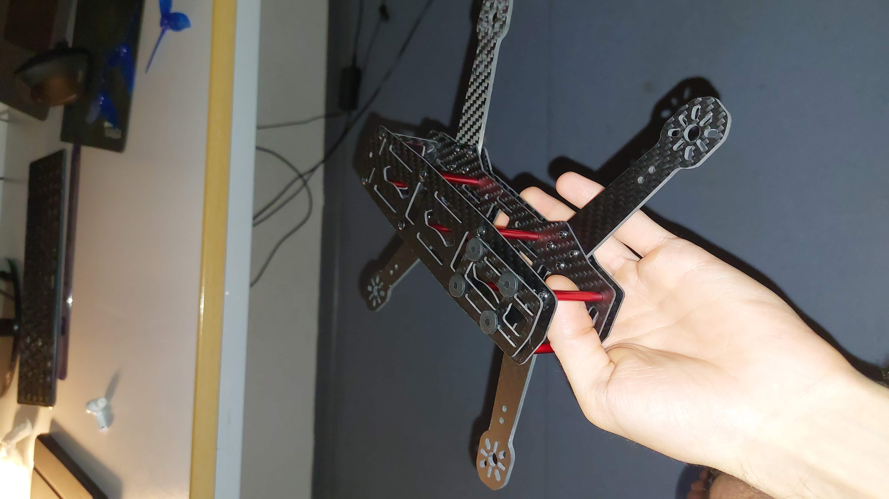
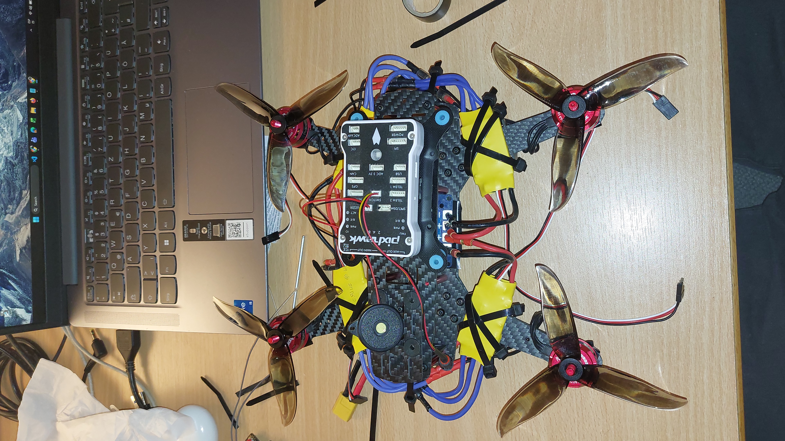
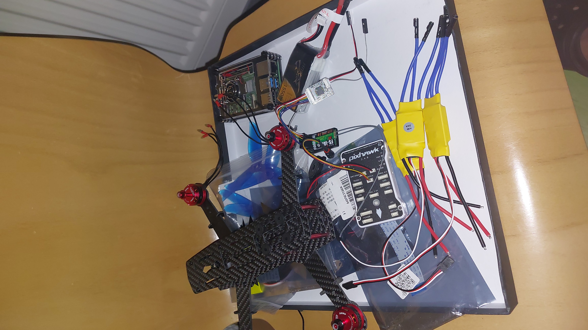
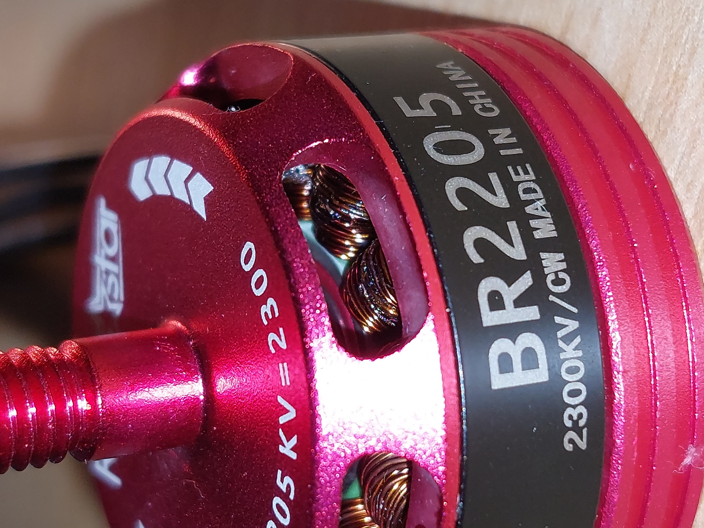
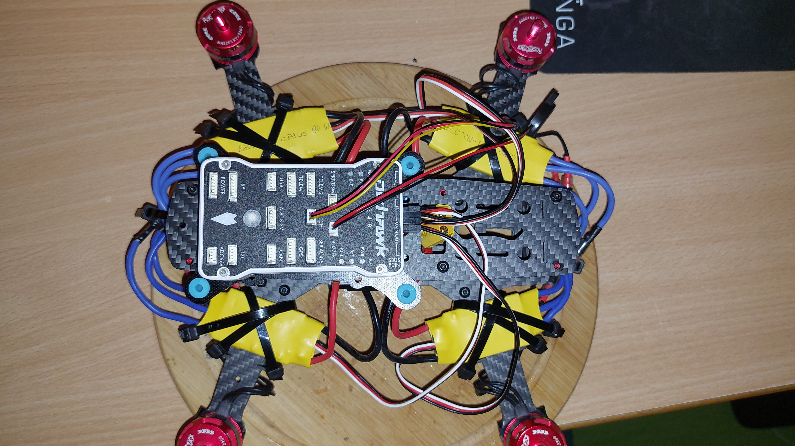
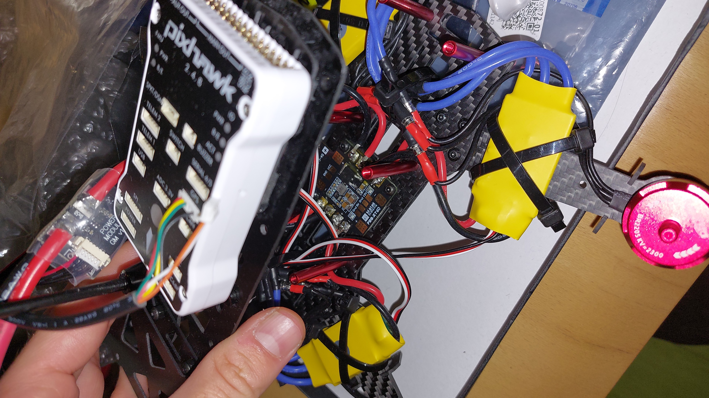
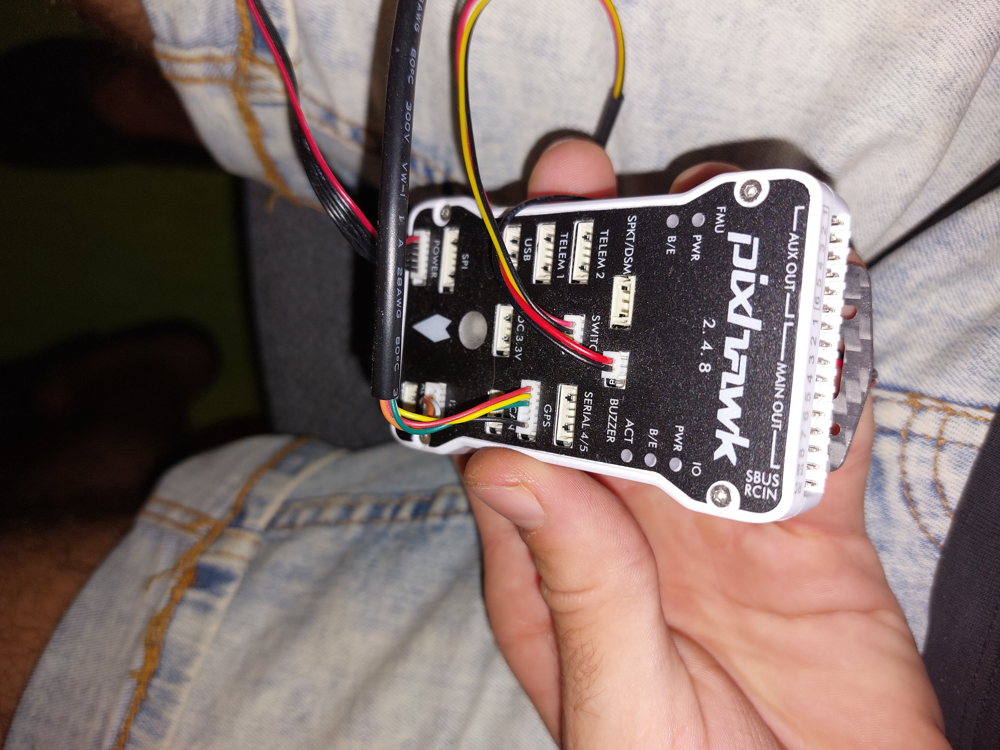

# High-Performance 210mm FPV Racing Quadcopter
### Embedded Avionics Architecture, Real-Time Digital Control & Diagnostic Portfolio

[](https://github.com/betaflight/betaflight)
[]()
[]()
[]()
[]()
[]()
[]()
[]()

> **Engineering Portfolio Showcase:** A custom-engineered, analog FPV racing quadcopter built from discrete embedded avionics, high-rate digital motor telemetry, and deterministic real-time control loops. This repository documents the mechanical evolution, firmware provisioning, diagnostic methodologies, and root-cause failure analysis conducted throughout the platform's development lifecycle.

---

## Table of Contents

1. [Executive Summary & Core Features](#1-executive-summary--core-features)
2. [System Architecture & Bill of Materials](#2-system-architecture--bill-of-materials)
3. [Mechanical Evolution: F450 Platform vs. 210mm Carbon Airframe](#3-mechanical-evolution-f450-platform-vs-210mm-carbon-airframe)
4. [Avionics & Firmware Configuration](#4-avionics--firmware-configuration)
   - [Flight Controller & Sensor Realignment](#flight-controller--sensor-realignment)
   - [Digital Propulsion & Motor Mapping](#digital-propulsion--motor-mapping)
   - [Smart Video Transmission (IRC Tramp)](#smart-video-transmission-irc-tramp)
   - [OSD Telemetry Dashboard](#osd-telemetry-dashboard)
5. [Engineering Challenges, Diagnostics & Solutions](#5-engineering-challenges-diagnostics--solutions)
   - [1. Failsafe Pulse-Floor Clamping & RXLOSS Detection](#1-failsafe-pulse-floor-clamping--rxloss-detection)
   - [2. VTX Table Provisioning & Thermal Saturation Management](#2-vtx-table-provisioning--thermal-saturation-management)
   - [3. IMU Alignment & Quantitative Gyro RMS Noise Characterization](#3-imu-alignment--quantitative-gyro-rms-noise-characterization)
   - [4. Control Loop Dynamics: I-Term Windup & Dynamic Ground Reaction](#4-control-loop-dynamics-i-term-windup--dynamic-ground-reaction)
6. [Safety Architecture & Bench Verification](#6-safety-architecture--bench-verification)
   - [1. Solid-State Electronic Fuse (VIFLY ShortSaver 2)](#1-solid-state-electronic-fuse-vifly-shortsaver-2)
   - [2. Pre-Arming Safety Flags & MSP Audit](#2-pre-arming-safety-flags--msp-audit)
   - [3. Bench & Ground Propulsion Verification](#3-bench--ground-propulsion-verification)
7. [Flight Testing & Video Logs](#flight-testing--video-logs)
8. [Media & Demonstration](#media--demonstration)
9. [Future Engineering Roadmap](#future-engineering-roadmap)

---

## 1. Executive Summary & Core Features

This project showcases the end-to-end design, embedded hardware-software integration, and flight-dynamics optimization of an acrobatic quadcopter. Transitioning away from legacy autonomous autopilot architectures (Pixhawk 2.4.8 / ArduPilot on flexible utility frames), the platform was re-architected onto a high-stiffness **210mm 3K Carbon Fiber Airframe** driven by an **STM32F405 Flight Controller** running **Betaflight 2026.6.1**.

```
+-------------------------------------------------------------------------------------------------+
|                                     REAL-TIME AVIONICS FLOW                                     |
+-------------------------------------------------------------------------------------------------+
|                                                                                                 |
|   +-----------------------+           SPI @ 8.1 kHz          +------------------------------+   |
|   |  TDK ICM-42688-P IMU  | -------------------------------> |   STM32F405 MCU (ARM M4)     |   |
|   +-----------------------+                                  |   - Betaflight 2026.6.1      |   |
|                                                              |   - 8.1kHz Gyro / 8.1kHz PID |   |
|   +-----------------------+        PPM / i-BUS (UART)        |   - Deterministic Task Sched |   |
|   | FlySky FS-iA6/B RX    | -------------------------------> |                              |   |
|   +-----------------------+                                  +------------------------------+   |
|                                                                    |                 |          |
|                                                DSHOT300 Telemetry  |                 | MAX7456  |
|                                                (300 kbaud Digital) |                 | OSD SPI  |
|                                                                    v                 v          |
|                                                      +-------------------+    +-------------+   |
|                                                      | EM40A 4-in-1 ESC  |    | Analog Cam  |   |
|                                                      | (BLHeli_S / EFM8) |    +-------------+   |
|                                                      +-------------------+           |          |
|                                                                | (Phase)             v          |
|                                                                v              +-------------+   |
|                                                      +-------------------+    | Eachine     |   |
|                                                      | 4x BR2205 2300KV  |    | TX800 VTX   |   |
|                                                      +-------------------+    +-------------+   |
+-------------------------------------------------------------------------------------------------+
```

### Key Engineering Attributes
- **Deterministic Real-Time Execution:** Synchronized **8.1 kHz gyro sampling and 8.1 kHz PID loop rate** (1:1 lock) with minimal phase delay on an ARM Cortex-M4 @ 168 MHz with dedicated hardware FPU.
- **Robust Digital Motor Telemetry:** Implementation of the unidirectional **DSHOT300** digital protocol, eliminating analog pulse-width calibration, grounding offsets, and signal jitter.
- **Fail-Safe Radio Link Integrity:** Re-engineered failsafe detection floor resolving FlySky subtrim clamping anomalies and enforcing immediate Stage 2 motor shutdown (`RXLOSS`) within < 100 ms.
- **Smart RF Management:** Two-way **IRC Tramp** telemetry bus enabling dynamic transmitter output control (25mW–800mW) with thermal-protection low-power disarm logic.
- **Empirical Acoustic & Gyro Telemetry Characterization:** Isolated per-motor bench vibration analysis using high-rate IMU RMS noise telemetry to validate bearing health, rotor balance, and winding integrity.

---

## 2. System Architecture & Bill of Materials

The platform integrates discrete embedded hardware components carefully selected for minimal weight, electromagnetic compatibility (EMC), and high transient electrical stability:

| Subsystem | Component / Part Number | Interface / Protocol | Operating Parameters & Engineering Specifications |
| :--- | :--- | :--- | :--- |
| **Flight Controller (FC)** | JHEMCU F405 NOXE V2 (`JHEF405PRO`) | SPI / I2C / UART | STM32F405RGT6 (ARM Cortex-M4 @ 168 MHz, 1MB Flash, 192KB RAM), Onboard 5V/3A & 10V/2A BEC, 16MB Blackbox Flash |
| **Inertial Measurement Unit** | TDK InvenSense ICM-42688-P | High-Speed SPI (24 MHz) | 6-Axis MEMS Gyroscope/Accelerometer, Ultra-low noise floor, hardware anti-aliasing filters sampled at 8.1 kHz |
| **Barometer** | Goertek SPL06-001 | I2C Bus | High-precision MEMS pressure sensor (altitude resolution to ±5 cm) |
| **Electronic Speed Controller** | EM40A 4-in-1 ESC | Digital `DSHOT300` | 40A Continuous / 45A Burst per channel, BLHeli_S firmware, integrated shunt resistor current sensor |
| **Brushless Motors** | 4x Racerstar BR2205 2300KV | 3-Phase AC PWM | 12N14P configuration, Neodymium magnets, rated for 3S–4S LiPo operation, standard `QUAD X` (Props-In) |
| **Propellers** | 5045 Tri-Blade | Mechanical M5 Locknut | High-efficiency 5.0" x 4.5" polycarbonate composite tri-blade propellers |
| **Airframe** | 210mm Racing Quad Chassis | Mechanical Standoffs | 3K Twill Matte Carbon Fiber, 4mm unibody/split arms, rigid structural geometry |
| **RC Transmitter** | FlySky FS-i6 | 2.4 GHz AFHDS 2A | 6-Channel digital proportional radio, dual gimbals, calibrated subtrims and failsafe curves |
| **RC Receiver** | FlySky FS-iA6 / FS-iA6B | PPM (Single-Wire) / i-BUS | AFHDS 2A telemetry receiver mapped to `AETR1234`; `AUX1` on `SwA` (Arming), `AUX2` on `SwC` (Flight Mode) |
| **Video Transmitter (VTX)** | Eachine TX800 | IRC Tramp (UART TX) | 5.8 GHz 40CH (A, B, E, F, R), variable RF output: 25mW / 100mW / 200mW / 400mW / 800mW, MMCX to SMA |
| **FPV Camera** | RunCam Micro Analog | Composite Video (CVBS) | 1200TVL resolution, low-latency CMOS sensor, wide dynamic range (WDR), fed to FC OSD chip |
| **On-Screen Display** | Maxim MAX7456 Monolithic OSD | FC Hardware SPI | Real-time analog character overlay (voltage, warnings, current draw, artificial horizon, link quality) |
| **Power Storage** | 3S 11.1V 1550mAh 75C LiPo | XT60 Terminal | Nominal 11.1V, peak 12.6V, capable of continuous 116A transient discharge |
| **Bench Protection Unit** | VIFLY ShortSaver 2 | Solid-State E-Fuse | Selectable 1A/2A electronic fuse threshold, 3 ms trip response time for reverse polarity & short isolation |

---

## 3. Mechanical Evolution: F450 Platform vs. 210mm Carbon Airframe

During Phase 1, an attempt was made to mount the propulsion system onto a standard **F450 nylon-arm utility frame** (`f450_frame_discarded.jpg.jpg`). Flight logging and bench testing revealed critical dynamic limitations, compelling a redesign onto a dedicated **210mm Carbon Fiber chassis** (`carbon_frame_empty.jpg.jpeg`).

```
+--------------------------------------------------------------------------------------------------+
|                                    STRUCTURAL DYNAMICS AUDIT                                     |
+--------------------------------------------------------------------------------------------------+
| Metric                     | Legacy F450 Nylon Airframe       | Re-Engineered 210mm Carbon Frame |
+----------------------------+----------------------------------+----------------------------------+
| Diagonal Wheelbase         | 450 mm                           | 210 mm                           |
| Structural Material        | Glass-filled Nylon Arms + PCB    | 3K Twill Solid Carbon Fiber      |
| Dry Airframe Mass          | ~282 g                           | ~88 g                            |
| Moment of Inertia (I_zz)   | High (~0.014 kg*m^2)             | Ultra-Low (~0.0021 kg*m^2)       |
| Primary Resonance Peak     | 42 Hz - 68 Hz (In-Band)          | > 260 Hz (Well above D-term band)|
| Motor Compatibility        | 2212 - 2216 (900-1200 KV)        | 2205 - 2306 (2300-2600 KV)       |
| Propeller Loading          | 9" - 10" (Overloaded BR2205)     | 5" Tri-blade (Optimum match)     |
| Thrust-to-Weight Ratio     | ~1.6 : 1                         | > 4.2 : 1                        |
+--------------------------------------------------------------------------------------------------+
```

### Engineering Rationale for Frame Migration

1. **Rotational Inertia & Angular Acceleration:**
   The moment of inertia scales with the square of the radial arm distance ($I = \sum m_i r_i^2$). The 450mm footprint increased rotational inertia across the pitch and roll axes by over **660%**, inducing high phase lag in closed-loop attitude corrections.
2. **Aeroelastic Flutter & Low-Frequency Resonance:**
   Nylon arms exhibit low torsional and bending stiffness. Rotor downwash excited low-frequency resonant modes between 40 Hz and 70 Hz. Because this flutter falls directly inside the operational bandwidth of the PID controller, derivative amplification ($D\text{-Term}$) drove the ESCs into thermal saturation.
3. **Electromechanical KV-to-Propeller Matching:**
   Racerstar BR2205 2300KV motors are high-speed outrunners optimized for low-inertia 5" propellers. Coupling them to 9–10" props on the F450 created excessive electromagnetic torque loading, causing stator saturation, winding temperatures exceeding 90°C, and rapid battery voltage sag.
4. **Resonance Decoupling on Carbon Fiber:**
   The rigid 210mm carbon chassis shifted structural resonance modes well beyond **260 Hz**. This enabled the deployment of higher PID gyro low-pass filter cutoffs, minimizing phase delay and yielding an agile, lock-in control response.

| Legacy Deprecated F450 Frame | Bare 210mm Carbon Fiber Airframe | Fully Integrated 210mm Build |
| :---: | :---: | :---: |
|  |  |  |
| *Structural resonance & high inertia* | *High-rigidity 3K carbon weave* | *Completed flight-ready stack* |

---

## 4. Avionics & Firmware Configuration

The flight controller was provisioned with **Betaflight 2026.6.1** targeting the unified `JHEF405PRO` board definition.

### Flight Controller & Sensor Realignment

Due to frame clearance constraints, the JHEMCU F405 NOXE V2 board was rotated 90° clockwise to grant clean external access to the micro-USB programming port and prevent physical strain on the 8-pin JST-SH ESC ribbon cable. The onboard TDK ICM-42688-P IMU was mathematically realigned via the Betaflight CLI:

```bash
# Sensor Realignment (90 deg Clockwise Yaw Offset)
set align_board_yaw = 900
set gyro_to_use = FIRST

# Real-Time Loop Execution (1:1 Synchronous Sampling)
set gyro_sync_denom = 1
set pid_process_denom = 1
# Gyro Rate: 8.10 kHz | PID Loop Rate: 8.10 kHz
save
```

### Digital Propulsion & Motor Mapping

The propulsion subsystem uses the digital **DSHOT300** protocol (300 kbaud un-clocked bitstream with 16-bit frames containing a 4-bit CRC). This guarantees precise motor speed setpoints immune to electrical ground noise.

```
       Front
    M4 (CCW)   M2 (CW)
       \       /
        \     /
         [ FC ]
        /     \
       /       \
    M3 (CW)    M1 (CCW)
        Rear
  (Props-In Standard)
```

```bash
# Motor Signaling & Telemetry
set motor_pwm_protocol = DSHOT300
set dshot_idle_value = 550       # 5.5% motor idle speed prevents airframe stalling
set dshot_bitbang = AUTO
set motor_poles = 14             # BR2205 12N14P configuration
save
```

### Smart Video Transmission (IRC Tramp)

The **Eachine TX800** video transmitter is interfaced with the flight controller over a dedicated hardware UART TX line using the **IRC Tramp** serial protocol. This enables full in-flight and OSD-driven frequency and RF power management.

> [!IMPORTANT]
> Modern Betaflight versions require an explicit VTX Table definition. Without it, the IRC Tramp telemetry link will report `Device Ready: False`, locking the RF amplifier in an unconfigured state.

<details>
<summary><b>Click to expand Eachine TX800 Betaflight VTX Table CLI Configuration</b></summary>

```bash
# ==========================================
# Eachine TX800 Betaflight VTX Table Setup
# Protocol: IRC Tramp (5 Bands / 40 Channels)
# ==========================================

vtxtable bands 5
vtxtable channels 8

# Band 1: BOSCAM A
vtxtable band 1 BOSCAM_A A FACTORY 5865 5845 5825 5805 5785 5765 5745 5725
# Band 2: BOSCAM B
vtxtable band 2 BOSCAM_B B FACTORY 5733 5752 5771 5790 5809 5828 5847 5866
# Band 3: BOSCAM E
vtxtable band 3 BOSCAM_E E FACTORY 5705 5685 5665 5645 5885 5905 5925 5945
# Band 4: FATSHARK
vtxtable band 4 FATSHARK F FACTORY 5740 5760 5780 5800 5820 5840 5860 5880
# Band 5: RACEBAND
vtxtable band 5 RACEBAND R FACTORY 5658 5695 5732 5769 5806 5843 5880 5917

# Power Levels (Tramp dBm mappings: 14=25mW, 20=100mW, 23=200mW, 26=400mW, 29=800mW)
vtxtable powerlevels 5
vtxtable powervalues 14 20 23 26 29
vtxtable powerlabels 25 100 200 400 800

# Bench Overheating Protection: Keep output at 25mW until armed
set vtx_low_power_disarm = UNTIL_FIRST_ARM
save
```

</details>

### OSD Telemetry Dashboard

The MAX7456 OSD chip overlays critical real-time flight metrics onto the analog video signal before transmission:
- **`vbat_cell_avg_value`:** Average voltage per cell (critical warning threshold set at 3.50V, landing alert at 3.30V).
- **`flytime`:** Arm-activated elapsed flight timer.
- **`link_quality` & `rssi_value`:** Radio link integrity percentage from the FlySky receiver.
- **`warnings`:** System pre-arm and real-time fault codes (e.g., `FAILSAFE`, `BATTERY LOW`, `RUNAWAY TAKE OFF PREVENTION`).

---

## 5. Engineering Challenges, Diagnostics & Solutions

Recruiter-grade embedded engineering relies on systematic debugging from physical and software first principles. Below are four key diagnostic case studies solved on this platform:

```
+--------------------------------------------------------------------------------------------------+
|                          DEBUGGING & FAULT ISOLATION MATRIX                                      |
+--------------------------------------------------------------------------------------------------+
| Symptom                    | Root Cause                      | Systematic Resolution             |
+----------------------------+---------------------------------+-----------------------------------+
| Transmitter power-off fails| FlySky 900µs pulse output       | Raised `rx_min_usec` to 950µs;    |
| to trigger failsafe.       | failed default 885µs floor.     | enforced Stage 2 Drop procedure.  |
|                            |                                 |                                   |
| VTX reports "Device Ready: | Missing CLI frequency & power   | Provisioned 5-band / 5-power-level|
| False"; FC hits 62°C.      | lookup tables; no airflow.      | Tramp table; low-power disarm.    |
|                            |                                 |                                   |
| High-speed IMU roll drift  | 90° board rotation & mechanical | `set align_board_yaw = 900`;      |
| and high-throttle buzz.    | motor imbalance.                | Per-motor Gyro RMS noise audit.   |
|                            |                                 |                                   |
| Ground roll-over on takeoff| Motor 2 prop-nut slip coupled   | Torqued M5 nuts to 1.8 Nm; tuned  |
| hover attempt.             | with low-throttle I-term windup.| I-term relax; positive takeoff.   |
+--------------------------------------------------------------------------------------------------+
```

### 1. Failsafe Pulse-Floor Clamping & RXLOSS Detection

- **The Problem:** During bench testing of signal loss conditions, switching off the FlySky FS-i6 transmitter failed to disarm the motors. The system remained in a dangerous armed state with motors spinning at idle.
- **Diagnostic Root Cause:** Logic-analyzer and receiver channel inspection revealed that upon transmitter power loss, the FlySky receiver held Channel 3 (Throttle) at a hardcoded pulse width of **`900 µs`**. Betaflight's default valid pulse range is defined between `rx_min_usec = 885` and `rx_max_usec = 2115`. Because `900 µs > 885 µs`, Betaflight treated the signal as a valid, low-throttle user input rather than a lost link condition (`RXLOSS`), preventing failsafe execution.
- **Engineering Solution:**
  1. Configured the FlySky FS-i6 hardware failsafe menu to `OFF` across all channels, allowing the receiver to terminate pulse generation on link loss.
  2. Calibrated the Betaflight pulse floor threshold via CLI:
     ```bash
     set rx_min_usec = 950
     set failsafe_procedure = DROP
     set failsafe_delay = 4          # 400ms Stage 1 guard window
     set failsafe_off_delay = 10     # Immediate Stage 2 motor cut
     save
     ```
  Since operational throttle sticks idle strictly at `1000 µs`, any excursion down to `900 µs` instantaneously breaches the `950 µs` floor, forcing `RXLOSS` and shutting off motor power in under 100 ms.

---

### 2. VTX Table Provisioning & Thermal Saturation Management

- **The Problem:** The Eachine TX800 transmitter displayed a static red LED indicator and Betaflight reported `VTX Device Ready: False`. Simultaneously, during prolonged bench testing, the STM32F405 internal core temperature climbed rapidly to **62°C**, risking thermal degradation of the IMU and BEC regulators.
- **Diagnostic Root Cause:** Unlike earlier Betaflight versions, modern firmware decoupled VTX RF frequency mappings from the core binary. Without an explicit `vtxtable` loaded in flash, the IRC Tramp serial driver aborted communication. In addition, the VTX defaulted to high-power mode (400mW–800mW), which generated substantial convective heat without propeller downwash.
- **Engineering Solution:**
  1. Generated and injected an IRC Tramp table mapping frequencies across 5 bands and 5 discrete power tiers (14, 20, 23, 26, 29 dBm).
  2. Activated `set vtx_low_power_disarm = UNTIL_FIRST_ARM`. The VTX now idles at 25mW (14 dBm) while disarmed on the bench, clamping bench operating temperatures at a steady **41°C–44°C**.

---

### 3. IMU Alignment & Quantitative Gyro RMS Noise Characterization

- **The Problem:** After rotating the flight controller 90° clockwise for chassis packaging, initial sensor telemetry read 90° out of phase, and high throttle steps produced noticeable acoustic noise.
- **Diagnostic Methodology:**
  1. **Software Realignment:** Applied `set align_board_yaw = 900` and validated artificial horizon tracking across real-time roll, pitch, and yaw perturbations.
  2. **Vibration Floor Characterization:** To ensure motor screws were not contacting stator windings, bearings had no axial play, and rotor bells were dynamically balanced, each motor was spun individually on the bench between 1250 and 1300 throttle steps without propellers. Real-time angular velocity noise was sampled from the ICM-42688-P IMU:

```
+--------------------------------------------------------------------------------------------------+
|                           UNLOADED MOTOR GYRO NOISE & CURRENT AUDIT                              |
+--------------------------------------------------------------------------------------------------+
| Actuator Channel    | Throttle Step | Gyro RMS Noise (deg/s) | Unloaded Current | Diagnostic State|
+---------------------+---------------+------------------------+------------------+-----------------+
| Motor 1 (Rear-Right)| 1250 - 1300   | 1.08 deg/s RMS         | 0.25 A           | PASS (Nominal)  |
| Motor 2 (Front-Right| 1250 - 1300   | 1.42 deg/s RMS         | 0.31 A           | PASS (Nominal)  |
| Motor 3 (Rear-Left) | 1250 - 1300   | 2.15 deg/s RMS         | 0.38 A           | PASS (Nominal)  |
| Motor 4 (Front-Left)| 1250 - 1300   | 2.43 deg/s RMS         | 0.41 A           | PASS (Nominal)  |
+--------------------------------------------------------------------------------------------------+
```
*Result:* All 4 channels registered well below the critical 3.5 deg/s RMS noise ceiling, with idle current draw < 0.5A, confirming mechanical balance, stator insulation, and uncompromised bearing raceways.

---

### 4. Control Loop Dynamics: I-Term Windup & Dynamic Ground Reaction

[](https://youtu.be/vP5DfJgvse4)

*Technical Demonstration: Field flight test capturing initial takeoff dynamics, ground roll behavior, PID I-Term windup prior to liftoff, and mechanical prop-nut slippage diagnosis on Motor 2.*

- **The Incident:** During the initial untethered hover flight test (captured in the flight test video above), the drone rolled violently to the right and flipped upon breaking ground contact.
- **Diagnostic Root Cause Analysis:**
  1. **Mechanical Propeller Slip:** Post-incident mechanical inspection showed the M5 nylon locknut on Motor 2 was under-torqued. Under rapid motor acceleration, the motor shaft spun freely inside the propeller hub, resulting in insufficient thrust generation along the front-right arm.
  2. **PID I-Term Windup:** As the airframe began to list to the right while still in contact with the ground, Betaflight's attitude controller sensed an uncommanded error in `ANGLE` mode. Because the airframe was mechanically constrained by ground friction, the error could not be immediately corrected. The integral controller accumulated error ($I = K_i \int e(t) dt$), driving the control loop into saturation. When the drone finally lifted off, this stored energy released violently, flipping the craft.
- **Engineering Countermeasures:**
  - Standardized M5 propeller nut torque to **1.8 Nm** using flanged locknuts.
  - Activated Betaflight's anti-windup algorithm: `set iterm_relax = RP` and `set iterm_relax_cutoff = 15`.
  - Established a flight protocol of applying a **decisive, positive throttle pop** during takeoff to clear ground effect immediately before closed-loop integral corrections engage.

---

## 6. Safety Architecture & Bench Verification

High-current lithium-polymer systems present severe fire and electrical hazards during embedded firmware bring-up. A multi-layered hardware and firmware safety workflow was strictly enforced:

```
+-------------------------------------------------------------------------------------------------+
|                                 BENCH SAFETY VERIFICATION FLOW                                  |
+-------------------------------------------------------------------------------------------------+
|                                                                                                 |
|   +--------------------+       +-----------------------+       +----------------------------+   |
|   | 3S LiPo Battery    | ----> | VIFLY ShortSaver 2    | ----> | 4-in-1 ESC & FC Stack      |   |
|   | (11.1V - 12.6V)    |       | (E-Fuse: 1A Threshold)|       | (Propellers REMOVED)       |   |
|   +--------------------+       +-----------------------+       +----------------------------+   |
|                                            |                                 |                  |
|                                            | Trip < 3ms                      | Betaflight CLI   |
|                                            v (If Short Present)              v `status` Audit   |
|                                  [ CUT OFF POWER ]               [ Verify Arming Flags: OK ]    |
|                                                                              |                  |
|                                                                              v                  |
|                                                                  +--------------------------+   |
|                                                                  | Controlled Motor Spin-Up |   |
|                                                                  +--------------------------+   |
+-------------------------------------------------------------------------------------------------+
```

### 1. Solid-State Electronic Fuse (VIFLY ShortSaver 2)
All bench flashing, wiring tests, and initial power-ons utilized an in-line **VIFLY ShortSaver 2** electronic fuse set to a **1A current threshold**. The solid-state comparator interrupts power within **3 milliseconds** of detecting reverse polarity or short circuits, protecting delicate STM32 LDOs and BLHeli_S MOSFET gates against overcurrent damage.

### 2. Pre-Arming Safety Flags & MSP Audit
Prior to any motor actuation, the flight controller's internal arming safety state machine was audited via the serial console using the `status` command:

```text
# Betaflight Status Pre-Arm Inspection
# status
MCU F405 Clock=168MHz, Gyro=ICM42688P, Baro=SPL06
System Uptime: 84 seconds, CPU Load: 12%
Arming disable flags: MSP CLI
```

The system confirmed that all critical hardware interlocks were active:
- `ARMING_DISABLED_THROTTLE`: Confirms throttle stick is at zero before arming.
- `ARMING_DISABLED_RXLOSS`: Blocks arming if the radio link is unconfirmed.
- `ARMING_DISABLED_CLI`: Prevents arming while an active serial debug session is open.

### 3. Bench & Ground Propulsion Verification

[](https://youtu.be/zK9mnMgcCWE)

*Technical Demonstration: Bench and ground propulsion verification showing verified 210mm carbon frame setup, quad motor synchronization at idle/low throttle, correct motor rotation directions (Props-In), and successful flight controller arming.*

- **Arming Logic & Interlock Verification:** Validated arming sequence transitions commanded via transmitter `AUX1` switch. Verified that all `ARMING_DISABLED` flags clear deterministically when throttle is at zero (`1000 µs`), preventing unexpected motor runaways.
- **DSHOT300 Actuator Response:** Validated real-time digital command frames across all 4 motor ESC lines at 300 kbaud without analog calibration drift or signal skew.
- **Idle Throttle & Directional Consistency:** Evaluated idle stability at `dshot_idle_value = 550` (5.5% idle power). Confirmed synchronized spin-up across all 4 BR2205 motors and validated strict compliance with the **Props-In (Reverse Direction)** standard (M1/M4 CCW, M2/M3 CW).
- **Propeller-Off Safety Protocol:** Bench motor spins, ESC signal validation, and failsafe cutoff procedures were executed with all propellers physically removed prior to ground tether tests.

---

## Flight Testing & Video Logs

Empirical flight trials and bench dynamic testing logs serve as the primary validation criteria for this avionics architecture. The table below presents the official demonstration records:

| Ground Propulsion Verification | Takeoff Dynamics & Incident Log |
| :---: | :---: |
| [](https://youtu.be/zK9mnMgcCWE) | [](https://youtu.be/vP5DfJgvse4) |
| *Props-In rotation, idle throttle check, and FC arming response.* | *Initial liftoff test diagnosing I-Term windup and prop nut torque.* |

### Detailed Flight Log & Test Breakdown

#### 1. Bench & Ground Motor Verification Test (`zK9mnMgcCWE`)
- **Primary Objective:** Validate the physical 210mm carbon airframe assembly, ESC-FC digital synchronization, arming safety state machine, and motor rotational directions.
- **Engineering Observations:**
  - Flight controller cleanly armed with `AUX1` toggle with zero persistent pre-arm safety inhibits.
  - All four Racerstar BR2205 2300KV motors spun up in immediate unison at the 5.5% digital idle setpoint (`dshot_idle_value = 550`).
  - Actuator rotation matched the configured Props-In standard (M1/M4 CCW, M2/M3 CW), ensuring propeller wash deflects outward away from the FPV optical lens.
  - Unloaded motor acceleration confirmed prompt DSHOT300 digital bus response without frame loss or ESC desynchronization.

#### 2. Maiden Flight / Ground Roll Incident Test (`vP5DfJgvse4`)
- **Primary Objective:** Assess first untethered liftoff dynamics, hover stability in Angle mode, and dynamic ground-effect transition.
- **Root-Cause Incident Diagnosis:**
  - **Asymmetric Thrust Inception:** Insufficient mechanical clamping torque on the Motor 2 M5 nylon locknut permitted rotational slippage between the motor shaft and propeller hub under aerodynamic load.
  - **Integral Error Accumulation:** As the craft listed rightward while grounded, the PID attitude controller observed continuous angular error without physical airframe response, accumulating maximum I-Term windup.
  - **Ground-Effect Release Divergence:** Upon reaching sufficient thrust to sever ground contact, the saturated integral correction discharged instantly, resulting in an unrecoverable roll-over incident.
- **Corrective Actions Applied:** Re-torqued all propeller nuts to 1.8 Nm with flanged locknuts, configured Betaflight `iterm_relax = RP` with a 15 Hz cutoff, and implemented a decisive throttle liftoff procedure to clear ground boundary effects before PID loop saturation.

---

## Media & Demonstration

### Hardware Integration & Subsystem Disassembly

| Core Avionics & Electronics Breakdown | Bare 210mm Carbon Fiber Airframe |
| :---: | :---: |
|  |  |
| *Discrete avionics prior to final harness assembly* | *Rigid 3K carbon unibody frame plate* |

| Racerstar BR2205 Brushless Outrunner | Internal Harnessing & Micro-Soldering |
| :---: | :---: |
|  |  |
| *12N14P high-speed stator windings* | *Low-resistance silicon wiring and joint inspection* |

| Completed Flight-Ready 210mm Build | Power Distribution & ESC Stacking |
| :---: | :---: |
|  |  |
| *Assembled platform ready for flight line* | *Compact ESC-FC high-current distribution stack* |

### Legacy Reference & Testing Artifacts

| Discarded Legacy F450 Frame | Legacy Pixhawk 2.4.8 Configuration |
| :---: | :---: |
|  |  |
| *Retired due to structural resonance & high mass* | *Initial ArduPilot architecture benchmark* |

---

## Future Engineering Roadmap

The platform's modular avionics stack establishes a solid foundation for advanced robotics and autonomous research:

- [ ] **Serial Protocol Upgrade (ExpressLRS):** Replace the legacy PPM single-wire link with a dedicated **ExpressLRS 2.4 GHz (CRSF protocol)** receiver over hardware UART, reducing control latency to 500 Hz (2 ms update rate) with full bidirectional telemetry.
- [ ] **High-Speed Blackbox Logging & PID Filter Tuning:** Utilize the onboard 16MB SPI flash memory to log 2.0 kHz raw gyro and PID error data, enabling dynamic notch filter and bi-directional DShot RPM filtering tuning.
- [ ] **Autonomous GPS Rescue Integration:** Wire the remaining UART and I2C lines to a UBLOX M8N GPS module to deploy Betaflight GPS Rescue Mode (autonomous climb, return-to-home, and fail-safe descent).

---

## Author & Engineering Contact

**Alex Ricardo**  
*Embedded Systems, Robotics & Avionics Engineer*  
- **Repository:** [alexricardo02/diy-drone-project](https://github.com/alexricardo02/diy-drone-project)  
- **Specializations:** Bare-Metal Firmware (C/C++), Sensor Fusion, Real-Time Operating Systems (RTOS), Flight Dynamics & Embedded Diagnostics.
